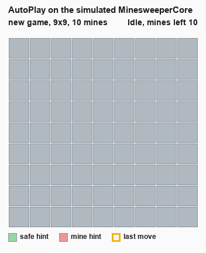
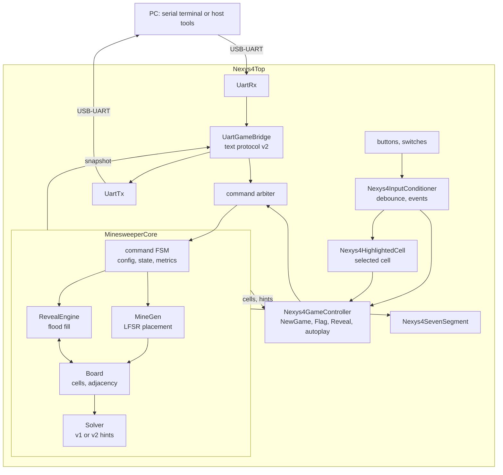
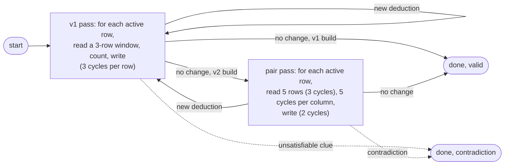

# FPGA Minesweeper

Parameterized Minesweeper in Chisel for a Digilent Nexys4 DDR Rev. C (Artix-7 XC7A100T-1CSG324C, 100 MHz oscillator). The FPGA runs the whole game:
- mine placement;
- a flood-fill reveal engine;
- a constraint solver that marks cells that are certainly safe or certainly mines.

The solver's hints are checked in two ways: z3 proves them sound on small boards, and simulation compares them with an exact oracle. A bitstream of the full design has been generated and programmed on the board, but implementation timing does not meet 100 MHz yet (see [Nexys4 DDR board](#nexys4-ddr-board)).



*A Beginner game (9x9, 10 mines) played on the simulated `MinesweeperCore` by AutoPlay. It reveals every safe hint (green) and guesses only when there is none. The golden model checked every move. To regenerate it: `sbt "Test/runMain minesweeper.AutoPlayFrames"`, then `python scripts/autoplay_gif.py`.*

## Architecture



The Core accepts one command at a time (NewGame, Reveal, Flag) and returns one result. While it holds that result, it exposes a stable snapshot: configuration, state, every public cell, the hints and the operation counters. The board controls and the UART bridge share the Core through the arbiter. All interfaces and timing rules are in [CONTRACT.md](docs/CONTRACT.md).

| Part | What it does | Main files | Written by |
|---|---|---|---|
| Core | Command FSM, settings, game state, revision and cycle counters | `MinesweeperCore.scala` | R1 |
| MineGen | 16-bit LFSR placement; the first click and its neighbours are kept free | `MineGen.scala` | R1 |
| Board | Cell storage (mine, revealed, flagged) and adjacency counts | `Board.scala` | R1 |
| RevealEngine | Flood fill, one ring of cells per cycle | `RevealEngine.scala` | R2 |
| Solver | Hints: v1 (one clue at a time), v2 (pairs of clues, off by default) | `Solver.scala` | R2 |
| UART | Bytes (`UartRx`, `UartTx`); lines, requests, replies (`UartGameBridge` and its parts) | `Uart.scala`, `Uart*.scala`, `S0Stubs.scala` | R3 (bytes), R1 (bridge) |
| Board top | Buttons, switches, selected cell, game controller, seven-segment display, LEDs | `Nexys4*.scala` | R1 |
| Model and checks | Golden model, model solvers, exact oracle (plain Scala, test references only) | `model/`, `host/` | R2 for R3, R3 |

Sizes are generated from `MsParams`. The production build has 30x24 storage and the five presets 8x8, 9x9, 16x16, 30x16 and 30x24. Smaller presets use the top-left part of the storage, and the rest is padding. Tests also build small verification capacities (for example 4x4, 7x5, 6x5), several with more than one preset.

## Build setup

The dependency versions are shared and match the course labs 6-8:

| Tool | Version |
| --- | --- |
| JDK | 17 or later (CI uses Temurin 17; tests also pass on Temurin 25) |
| sbt | 1.12.13, pinned in `project/build.properties` |
| Scala | 2.13.16 |
| Chisel and compiler plugin | 6.7.0 |
| ChiselTest | 6.0.0 |
| ScalaCheck (tests) | through scalatestplus `scalacheck-1-18` 3.2.19.0 |
| z3 (formal proofs only) | any recent version on the PATH |
| Python and Pillow (animation only) | Python 3 with Pillow |

Install a JDK 17 (or later) and sbt. Scala, Chisel and ChiselTest are downloaded by sbt; separate Scala or Chisel installations are unnecessary. The installed sbt launcher may be newer: the repository pin selects the build version. If your sbt launcher is 2.x and complains, check that you are in this repository and that `project/build.properties` is present.

On Windows, set `JAVA_HOME` to the JDK directory (the folder containing `bin`), and put its `bin` directory first on PATH. For a PowerShell session:

```powershell
$env:JAVA_HOME = 'C:\path\to\jdk-17'
$env:Path = "$env:JAVA_HOME\bin;$env:Path"
java -version
javac -version
```

Run the commands below from the repository root. Both Java commands should report version 17 or later. In IntelliJ, select the same JDK for both Project SDK and sbt JVM (temurin-17 or temurin-25), then reload sbt. The first run downloads the dependencies and the CIRCT `firtool` binary used for Verilog emission, so it needs internet access. `.jvmopts` gives sbt 2 GB of heap and an 8 MB thread stack, which elaborating the 30x24 top needs.

## How to run

| What | Command | Time |
|---|---|---|
| Fast tests, as in CI | `sbt "testOnly -- -l minesweeper.Formal"` | 12-13 min in CI, about 40 min on a laptop |
| Formal proofs (z3 on the PATH) | `sbt "testOnly -- -n minesweeper.Formal"` | 13-17 min in CI |
| Fast tests and proofs | `sbt test` (or `make test`) | the two above together |
| Contract tests | `sbt "testOnly minesweeper.ContractTest"` (or `make contract`) | under a minute |
| One test class | `sbt "testOnly minesweeper.PropertyTest"` | |
| Slow tests (30x24 capacity, long co-simulation) | `sbt "set Test / testOptions := Nil" "testOnly -- -n minesweeper.Slow"` | hours; the two long `CoSimTest` runs also need `COSIM_LONG=1` |
| Play in the terminal | see below | |
| Solver statistics | `sbt "Test/runMain minesweeper.AutoPlay"` | 32 min; writes `results/solver_stats.csv` |
| The animation above | `sbt "Test/runMain minesweeper.AutoPlayFrames"`, then `python scripts/autoplay_gif.py` | a few minutes |
| Verilog for the board | `sbt "runMain minesweeper.EmitNexys4Top"` | writes `generated/nexys4/top/Nexys4Top.sv` |

`build.sbt` leaves the slow tests out of every `sbt test` and `testOnly` run. Current tests use the default simulator and do not need Verilator. GitHub Actions runs the fast tests (`build` job) and the proofs (`formal-tools` job, which installs z3) for every push to `main` and every pull request. Vivado 2026.1 is the synthesis tool for the board; its project files are not in this repository. `make clean` removes build output only.

**Play in the terminal:**

```text
sbt "set Test / run / fork := true" "set Test / run / connectInput := true" "Test/runMain minesweeper.PlayConsole 6 6 5 1"
```

This plays a 6x6 game with 5 mines (seed 1) on the simulated `MinesweeperCore`, with solver hints, and the golden model checks every move.
- Commands: `r <row> <col>` reveal, `f <row> <col>` flag, `a` reveal a safe hint, `h` hints on or off, `n` new game, `q` quit.
- Without a keyboard, add `--script "r 2 2; a; q"` and drop the two `set` commands.
- Details are in [R3_S1.md](docs/R3_S1.md).

## Verification

| Where | Tests | When |
|---|---:|---|
| CI `build` job | 172 | every push to `main` and every pull request |
| CI `formal-tools` job | 20 z3 proofs | same |
| By hand, slow tag | 8 | 30x24 capacity and long co-simulation |

These counts come from the CI run of 10 November 2026. What the tests check, by layer (number of tests in CI, plus slow ones):
- **Contract and geometry.**
  - `ContractTest` (12): presets, mine bounds, derived widths, stride and padding, neighbour sets, LFSR period and placement, UART divisor, interface elaboration.
  - `RefGridTest` (8).
- **Modules alone.**
  - Game modules: `BoardTest` (9), `MineGenTest` (4 + 1 slow), `CoreTest` (10), `RevealEngineTest` (9 + 1 slow), `SolverTest` (17 + 3 slow).
  - UART: `UartTest` (12), `UartLineReceiverTest` (4), `UartRequestDecoderTest` (4), `UartTransactionTrackerTest` (4), `UartReplySerializerTest` (3), `UartBridgeTest` (1), `UartRxLinesTest` (1).
  - Protocol: `ProtocolTest` (11), `ProtocolFixtureTest` (10).
- **Golden model**, plain Scala written from the contract: `GoldenModelTest` (13), `ModelSolverTest` (12).
- **Co-simulation.** The model and the simulated `MinesweeperCore` run the same commands, and every public field is compared after every command.
  - `CoSimTest` (5 + 2 long): invalid settings and coordinates, flags, win and loss, preset switches, random command sequences on three capacities.
  - `SolverCoSimTest` (3 + 1 slow): the hardware Solver against `ModelSolver` v1 and v2 on boards of played games, including 9x9.
- **Properties.** `PropertyTest` (2) uses ScalaCheck to generate capacities (2 to 9 rows and columns), games and moves, and checks twelve game properties after every command:
  - the cascade equals a breadth-first search;
  - a revealed cell is never a mine and shows its true count;
  - the game is won exactly when every safe cell is revealed;
  - `minesLeft = mines - flags`;
  - hints are sound, certain, and unchanged by flags;
  - commands that change nothing leave the view unchanged;
  - and more.

  Each run plays 500 model games and 12 hardware games in lockstep with the model. See [R3_S3.md](docs/R3_S3.md).
- **Exact oracle.** `SolverOracleTest` (8). `SolverOracle` tries every mine layout that fits the revealed numbers. Every v1 and v2 hint must be a cell that is the same in all of them.
- **Formal proofs**, z3 through ChiselTest:
  - Solver v1 by induction on 3x3, 4x4 and padded 4x3 builds;
  - the v2 pair rule for all 12 partner positions;
  - Board with RevealEngine, bounded.

  See [What is proven](#what-is-proven).
- **Statistics.** `AutoPlayTest` (1), a short version of the AutoPlay run below.
- **Other.** `R2DemoConsoleTest` (4), `R2ElaborationTest` (2), `S0SmokeTest` (2), `SimulationDemoTest` (1).

**Mutation checks.** These bugs were injected on purpose to check that the tests catch them. Each was caught, then reverted:
- a cascade that also expands from numbered cells, in the hardware (z3, `RevealEngineTest`) and in the model (co-simulation, properties);
- a Core that skips showing the mines on a loss (co-simulation);
- solver deductions written one row off, and the all-mines test comparing the clue with the mine count (z3);
- |X| and |Y| swapped in the v2 bound (z3);
- a win declared one cell early, and no solver run after a flag (properties).

The development logs list the others ([AI_USAGE.md](docs/AI_USAGE.md)).

Not covered: production-size games on the simulated hardware (a 30x24 game takes hours with the default simulator), timing closure, and play on the physical board.

## Solver statistics

`sbt "Test/runMain minesweeper.AutoPlay"` plays games with the hints and writes [results/solver_stats.csv](results/solver_stats.csv):
- the player reveals every safe hint, and guesses a random hidden cell only when there is none;
- a v1 player follows the hardware's hints, a v2 player follows `ModelSolver.solveV2`;
- on every board where the player chooses a move, the hints are compared with the exact oracle.

| Grid, mines | Player | Games | Won | Won without guessing | Guesses per game | Certain cells found by v1 / v2 |
|---|---|---:|---:|---:|---:|---:|
| 9x9, 10 (Beginner) | v1 | 1000 | 810 | 578 | 0.83 | 82.9% / 99.7% |
| 9x9, 10 (Beginner) | v2 | 1000 | 922 | 789 | 0.26 | 90.4% / 99.7% |
| 9x9, 14 (production default) | v1 | 1000 | 442 | 193 | 2.02 | 74.2% / 99.7% |
| 9x9, 14 (production default) | v2 | 1000 | 749 | 473 | 0.85 | 87.7% / 99.6% |
| 4x4, 3, hardware | v1 | 25 | 15 | 4 | 1.60 | 52.7% / 98.3% |
| 7x5, 6, hardware | v1 | 25 | 18 | 10 | 1.16 | 77.6% / 99.0% |

- **v2 against v1.** Comparing pairs of clues finds 98 to 99.7% of the cells that can be deduced from the numbers, against 53 to 90% for v1.
- **Effect on play.** On Beginner, the v2 player wins without guessing in 79% of games, against 58% with v1.
- **Hardware against model.** The 50 hardware games equal the same games on the model.
- **Solver time.** One v1 solver run takes 26 cycles on average on 4x4 and 42 on 7x5.

Details: [R3_S4.md](docs/R3_S4.md).

## Reveal engine

`RevealEngine` opens the cells of a click (CONTRACT 5.5). It is a flood fill that reveals one ring of cells per clock cycle:
- a `frontier` register holds the cells revealed in the current cycle; the clicked cell is the first ring;
- the next ring is every neighbour of a zero cell of the frontier that is still eligible: active, hidden, unflagged and not yet visited by this reveal. Numbered cells are revealed but do not expand;
- a private `visited` register stops the engine from visiting a cell twice while the Board commits the previous ring, so `revealSet` depends only on registers: there is no combinational loop through the Board.

A reveal takes one cycle per ring (`cycles` equals `layers`). An empty board clicked in a corner needs max(rows, cols) rings. The neighbour wiring is fixed for the 30x24 capacity, and the eligibility mask removes the padding of smaller presets. In R1's routed Vivado build of 4 November 2026 the engine uses 1,504 LUTs and 1,483 flip-flops.

`RevealEngineTest` (10 tests) covers a numbered cell, a zero region and its numbered border, a wall of flags, the corner case above, cells revealed earlier, a small preset inside the capacity, starts that must be ignored, busy and clear, an independent BFS on 20 random layouts per configuration, and the 30x24 capacity (slow tag). The formal proof is listed under [What is proven](#what-is-proven).

## Solver and formal proofs

`Solver` computes the hints of CONTRACT 5.6: cells that are certainly safe or certainly mines, given the revealed numbers. It sees only the revealed cells and their numbers, never the mine layout.

### Rules

- **v1, one clue at a time.** For a clue, M is the number of deduced mines around it and U the set of its unknown neighbours (hidden and not deduced yet). With k = clue - M: k = 0 makes every cell of U safe, k = |U| makes every cell of U a mine, and k < 0 or k > |U| is a contradiction.
- **v2, pairs of clues, off by default.** Take two clues at most two cells apart, with unknown sets A and B and residuals a and b, and let I = A ∩ B, X = A - B, Y = B - A. The number of mines in I lies between L = max(0, a - |X|, b - |Y|) and U = min(|I|, a, b). L > U is a contradiction. If L = U = q, then I holds q mines, X holds a - q and Y holds b - q, and each part is tested for "no mine" and "all mines". This covers a clue whose cells contain another's, and partial overlaps such as 1-2-1 against a wall. `SolverConfig(subsetRule = true)` turns v2 on.

The rules repeat until nothing changes. On a consistent board they only add true facts, so the order in which the clues are visited does not change the result. Hints are shown only after a run that ends without a contradiction (`valid`).

### Schedule

The rule logic exists for one row of clues, not for every cell: the first, fully parallel version needed 26,641 LUTs in Vivado, 42% of the FPGA.



- **v1 step on row r, 3 cycles:** rows r - 1 to r + 1 go into registers (unknown cells, deduced mines, clues of row r); each clue of row r counts M and U and the rule results are registered; the deductions are written into the knowledge.
- **Pair pass on row r, v2 only:** rows r - 1 to r + 3 are read (3 cycles). Then for each active column c, 5 cycles: select the 5x7 region around (r, c), compute the constraints of the centre clue and its 12 partners, the bounds, the decisions, and add the deductions to a pending buffer. The pending rows are written last (2 cycles).

### Size and speed

| Solver alone | v1 (default) | v2 (`subsetRule = true`) |
|---|---|---|
| LUTs, Vivado (R1's routed build, 4 Nov 2026) | 8,687 | not built yet, about 11,600 estimated |
| LUTs, Yosys (30x24) | 11,506 | 15,368 |
| Flip-flops, Yosys | 1,914 | 3,696 |
| Longest path, Yosys | 8 logic levels | 10 logic levels |

R1's routed build of 4 November 2026 does not meet 100 MHz yet. Its 20 worst setup paths are outside the Solver and the RevealEngine; the slack of these two modules has not been reported yet.

A v1 pass takes 3 cycles per active row. On a model of the schedule with 200 played games per preset, a solve takes at most 216 cycles on 9x9 and 576 on 30x24 (under 6 µs at 100 MHz). With v2, the simulations measured 126 to 239 cycles on 4x4 games, 216 to 480 on 7x5 and up to 1,012 on 9x9. One UART byte at 115,200 baud takes about 87 µs.

### Tests

`SolverTest` has 20 tests, 3 of them with the slow tag:
- hand-made boards: one clue, chained deductions, nothing to deduce, padding, contradiction, the busy and clear handshake; for v2, 1-1 and 1-2-1 against a wall and the contract's partial overlap, which v1 cannot finish;
- soundness: on random 4x4 games, no hint contradicts any mine layout that fits the clues (every layout is enumerated);
- equality with Scala references written in the test, which share no code with the hardware: the v1 fixpoint and its cycle count on 20 played games per configuration, and the v2 closure on 4x4, 7x5 and 9x9 games;
- the 30x24 capacity with 9x9 and 30x16 games (slow).

Slow tests: `sbt "set Test / testOptions := Nil" "testOnly minesweeper.SolverTest minesweeper.RevealEngineTest -- -n minesweeper.Slow"`.

### What is proven

z3 proofs with ChiselTest, on small boards only:

| Property | Module | Sizes | Method |
|---|---|---|---|
| A safe hint is never a mine, a mine hint is always a mine, never both, never on a revealed or inactive cell; consistent clues are never reported as a contradiction | Solver v1 | 3x3, 4x4, 4x3 storage with 4x3 and 3x2 games | induction: true after any number of steps and runs |
| No consistent clue is judged unsatisfiable, no consistent pair has L > U, every deduction in I, X and Y is true | v2 pair rule (`PairRule`) | the 5x7 region, all 12 partner positions | one cycle, any layout and any sound knowledge |
| A cascade never reveals a mine or a flagged cell, a revealed cell never becomes hidden, every reveal ends within cells + 1 cycles | Board + RevealEngine | 3x3, 4x4, 4x3 storage | bounded: cells + maxRows + 4 cycles from reset |

Injected bugs were each found by z3 and then reverted: deductions written one row off, the all-mines test comparing the clue with M, a cascade expanding from numbered cells, |X| and |Y| swapped in L.

Not proven: boards larger than 4x4 and the 30x24 capacity (tests and co-simulation only), that the solver finds every deduction, the v2 control around the pair rule (simulation only), the cycle bounds, MineGen, the Core and the UART path. Details, runtimes and assumptions: [R2_S3_FORMAL.md](docs/R2_S3_FORMAL.md) and [R2_S4_SOLVER_V2.md](docs/R2_S4_SOLVER_V2.md).

Run the proofs with `sbt "testOnly -- -n minesweeper.Formal"` (z3 on the PATH). CI runs them in the `formal-tools` job and everything else in the `build` job.

## Nexys4 DDR board

`Nexys4Top` puts the Core on the board. Its code does the following:
- **Choosing a game.** After reset the board is in selection mode:
  - the direction buttons step through the five presets, and the LEDs show the chosen one;
  - the centre button starts a game on that preset, with 14, 14, 40, 99 or 130 mines and a seed that changes with each new game;
  - after a win or a loss, the centre button returns to selection mode.
- **Playing.**
  - The direction buttons move the selected cell inside the active grid.
  - Switch 1 flags the selected cell and switch 2 reveals it.
  - Switch 3 starts autoplay, which reveals safe hints one after another until none is left; it never guesses.
  - An action fires when its switch goes from off to on.
  - Switch 0 (hints) is debounced but not yet connected to anything.
- **Display.** The four seven-segment digits show the mines left, with a sign digit for over-flagging. LD16 is green while playing; on a win, the four LEDs, LD16 and LD17 blink green; on a loss, LD16 and LD17 blink red.
- **UART.** `UartRx` and `UartTx` (115,200 baud) connect the board's USB-UART pins to the `UartGameBridge`, which speaks the text protocol of CONTRACT 6 ([docs/protocol](docs/protocol/README.md)). A PC can therefore play the same game; the board controls and the bridge share the Core through an arbiter.

**Hardware status, from R1's Vivado 2026.1 runs:**
- **30 October 2026, first full-design bitstream.** 55,734 LUTs (87.91%), 6,328 registers (4.99%), 28 LUTRAMs, no block RAM on the `xc7a100tcsg324-1`. The routed timing failed 100 MHz: WNS -19.845 ns, with the critical path in MineGen (29.734 ns, 40 logic levels). The bitstream was programmed on the board, and the LEDs respond.
- **Early November, `feature/lut-reduction` branch** (row-by-row solver and a Board change): 50,004 LUTs (79%). Timing still fails 100 MHz. Its 20 worst setup paths are outside the Solver and the RevealEngine (see [Size and speed](#size-and-speed)).
- **Not done yet:** timing closure, the hint switch, a board display on the PC, and full games on the physical board.

## Shared contract

[CONTRACT.md](docs/CONTRACT.md) fixes:
- the presets and legal mine counts;
- the LFSR and the placement sequence;
- the storage layout and padding;
- the handshake and timing of every engine;
- the UART protocol.

Parameter definitions and shared interfaces are in `src/main/scala/minesweeper` (`Params.scala`, `Interfaces.scala`).

## AI usage

Most of the code, tests and documents were written with AI assistants, under the team's direction and review. The log of each story, with what was checked, is in [docs/AI_USAGE.md](docs/AI_USAGE.md). This section is a summary of that log. R1 and R3 should complete it for the final report: the log has no entries yet for the modules they wrote after S0.

**What was generated.**
- **R1 with Codex:** the shared contract, the parameter definitions and interfaces, the contract tests, the module shells and the S0 setup (licence, CI, pull-request template).
- **R2 with Claude Code (Anthropic):** the RevealEngine, both Solver versions, their tests, the formal harnesses and the CI job.
- **R3's stories, done by R2 with Claude Code while R3 was unavailable:** the golden model, the model solvers, the co-simulation, the property tests, the exact oracle, AutoPlay and most of this README.

**How it was checked.**
- **Tests first.** The RevealEngine and Solver v1 tests were written before the code, from the contract, and first failed against the shells.
- **Independent references.** The hardware was compared with references that share no code with it: breadth-first searches and fixpoints written in the tests, the golden model, a model solver that decides pairs by enumeration, and the exact oracle.
- **Every command compared.** Co-simulation compares every public field after every command.
- **Properties and proofs.** ScalaCheck properties hold on generated games, and z3 proves the solver and the cascade sound on small boards.
- **Mutation checks.** Bugs injected on purpose were caught (see [Verification](#verification)).
- **Recorded numbers.** Numbers in the documents come from recorded runs: test logs, CI, Yosys, and R1's Vivado reports.

**What was rewritten or dropped after review.**
- **Parallel Solver.** The first, fully parallel Solver used 26,641 LUTs in R1's Vivado run (42% of the FPGA). It was rewritten to work one row at a time and now uses about 8,700 LUTs.
- **First v2.** The first v2, built on the parallel v1, was dropped for one built on the row-by-row v1.
- **Bounded proof.** A bounded proof of whole solver runs did not finish on 3x3 in 80 minutes. It was replaced by an induction proof.
- **Simulation-speed rewrite.** A one-Bool-per-cell rewrite of the solver, meant to speed up simulation, gave no gain and was reverted.
- **Bugs found by the checks:**
  - the oracle merged two mine counts (found by its enumeration test);
  - chiseltest's idle timeout stopped long v2 solves (found by the 9x9 test);
  - the starter tests had to be ported to Chisel 6.

**Limit.** The same assistant wrote R2's hardware and the references used to check it: the golden model, the model solvers and the oracle. They are written from the contract and share no code with the hardware, but this is weaker than a second person writing them. R3's review of these files is still pending.

## License

MIT for original project contributions. See [LICENSE](LICENSE) and [third-party notices](THIRD_PARTY_NOTICES.md) for the starter material and its unresolved reuse terms.
