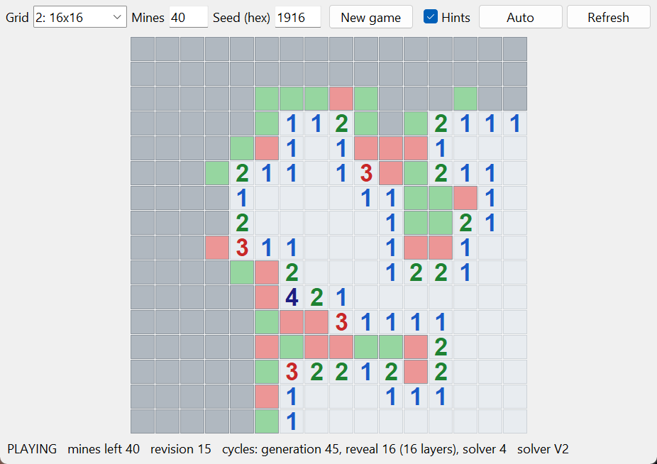

# PC display for the board

16 November 2026. Branch `r3/pc-display`.

The plan's display was VGA (R3-S2). The team dropped VGA for the Nexys4 DDR's UART, buttons and seven-segment display, and planned "a board display on the PC" without assigning it. Since R3 was unavailable, R2 wrote it with Claude Code. R3 and R1 should review it, and R1 should try it on the board.

| File | Content |
| --- | --- |
| `scripts/board_display.py` | The display: a window (tkinter) or a terminal version, talking UART protocol 2 |
| `scripts/test_board_display.py` | Its tests against the contract's protocol fixtures |
| `src/test/scala/minesweeper/ModelDevice.scala` | A board that speaks the protocol, backed by the golden model (`ModelDevice`), and `SimBoardServer`, which serves it on a TCP port |
| `src/test/scala/minesweeper/ModelDeviceTest.scala` | `ModelDevice` against the 8 fixture sessions, and whole games |
| `docs/figures/pc_display.png` | The window on a 16x16 game |



## Use

Install Python 3 and pyserial (`pip install pyserial`); tkinter comes with Python. Then run one of:

```text
python scripts/board_display.py --port COM5                       # the board (its USB-UART port)
python scripts/board_display.py --port COM5 --text                # terminal version
sbt "Test/runMain minesweeper.SimBoardServer 7777"                # no board: the model board on a TCP port
python scripts/board_display.py --port socket://localhost:7777    # then connect to it
```

On Windows the board's port appears in the Device Manager under "Ports (COM & LPT)" once the USB cable is plugged in.

**On the board, switch 0 must be on**, or the board sends no hints: the grid shows none and Auto does nothing. Hints only appear after the first reveal, and only when a deduction exists.

**Window.**
- Choose the grid, the number of mines and the seed (hex), then press **New game**.
- Left click reveals a cell, right click flags it.
- **Hints** shows or hides the solver's hints: green means safe, red means mine.
- **Auto** reveals safe hints one by one until none is left.
- **Refresh** asks the board for its current state.
- The bar at the bottom shows the state, the mines left, the revision, and the cycle counts the hardware measured (generation, reveal with its layers, solver).

**Terminal version.** The commands are:
- `r <row> <col>` to reveal, `f <row> <col>` to flag;
- `a` for one safe hint, `auto` to reveal safe hints until none is left;
- `n <preset> <mines> [seed]` for a new game;
- `g` to get the current state, `q` to quit.

`--script "..."` runs commands separated by `;`.

## What the display checks

The display never computes the game: every picture is a snapshot the board sent.

**Before showing a snapshot**, it checks it as CONTRACT 6.2 asks:
- the sequence numbers;
- one ROW and one HINT per row, with `cols` tokens each;
- the END revision matches the SNAP revision (`SNAPX`/`ENDX` with hex counters are accepted too, CONTRACT 6.4);
- no mine before a loss;
- no hint while `hintsValid` is 0, and none on a revealed cell;
- `minesLeft = mines - flags`.

**Timeouts and errors:**
- Timeouts are 2 s per reply line and 10 s per request (CONTRACT 6.3).
- After a timeout or a bad reply, it recovers with HELLO then GET. It never repeats a move by itself.
- An `ERR` is shown as "Board refused: CODE".
- On connection, HELLO checks that the board speaks protocol version 2, and reads the presets and the solver mode.

## Tests

| Test | Result |
| --- | --- |
| `python -m unittest scripts/test_board_display.py` | 6/6 (two hex-snapshot tests added by R1 in PR #28). For every fixture request the client can produce, the client writes exactly the fixture's line and accepts its replies. Broken snapshots are refused (mine before a loss, END revision, minesLeft, hint on a revealed cell, missing token, wrong sequence) |
| `sbt "testOnly minesweeper.ModelDeviceTest"` | 2/2. The model board answers all 8 fixture sessions (965 lines, 42 snapshots). Following its safe hints never loses, and won 22 of 40 games on 5x4 |
| By hand, against `SimBoardServer` | Text version: a refused NEW (BAD_MINES), a game won with `auto`, a refused reveal (RANGE). Window: the screenshot above |

**A bug found on the way**, in the `host` code. `Replay.run` never sent the LF that ends a request, so it only worked against the scripted mock device, which did not expect it either. Both now use `Fixture.wire`, and `ProtocolFixtureTest` and `ProtocolTest` still pass. `Replay` can now check a real device: the model board, the Chisel bridge, or the FPGA.

## Not done

- **On the FPGA.** R1 reported on 16 November that games play on the board over the UART, and adapted the display to the board's hex snapshots (PR #28). The hints and Auto on the board (switch 0 on) and the match with the seven-segment display are not confirmed yet.
- **The Python tests are not in CI.** The CI image has Python but not pyserial. Run them by hand.
- **The losing click.** The protocol has no exploded-cell field, so after a loss the window shows every mine the same way.
